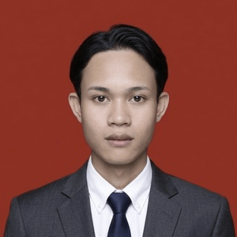
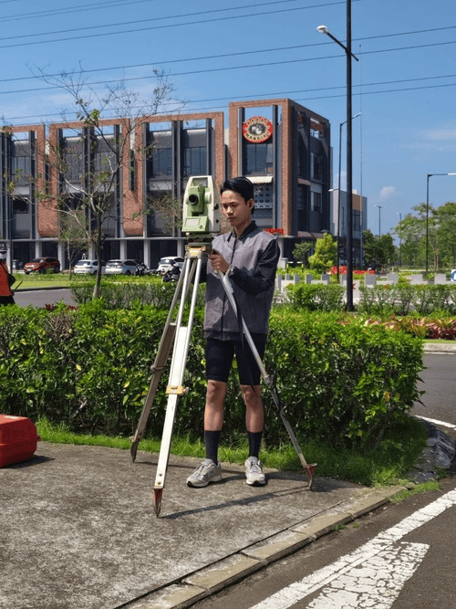

---
hide:
  - toc
  - navigation
---

  
  <h1>Rayhan Dwia Rukmana</h1>
  
<strong>Geomatics Student · 3D Mapping &amp; Photogrammetry</strong>

  
<em>Turning field measurements and imagery into maps and 3D models.</em>

---

## About Me

I am a Geodetic and Geomatics Engineering student at Universitas Lampung with a vocational background in Geomatics. I have collected field data with GNSS RTK, Total Station and levelling, processed photo data into orthomosaics and DEM/DSM in Agisoft Metashape, and built 3D models in SketchUp. Outside class, I contribute to humanitarian mapping on OpenStreetMap, with thousands of edits across 13 countries. I am looking for an internship from January 2027 in 3D mapping, photogrammetry, point clouds or 3D modelling, and I adapt my methods to the equipment available.

  

---

[View My Projects :material-arrow-right:](projects/index.md){ .md-button .md-button--primary }
[Download CV (Bahasa Indonesia)](assets/Rayhan-CV.pdf){ .md-button }

---

## Skills

-   :material-cube-outline:{ .lg .middle } **3D & Photogrammetry**

    ---

    - Agisoft Metashape: orthomosaic, DEM/DSM
    - SketchUp 3D modelling, with Ruby scripting
    - Revit (introductory)

-   :material-layers:{ .lg .middle } **GIS & Mapping**

    ---

    - QGIS, ArcGIS
    - AutoCAD: long section and cross section
    - Spatial data processing and map layout

-   :material-ruler:{ .lg .middle } **Field Survey**

    ---

    - GNSS / GPS RTK
    - Total Station
    - Levelling (waterpass)
    - Manual taping where signal is unavailable

-   :material-map-marker-radius:{ .lg .middle } **Humanitarian Mapping**

    ---

    - OpenStreetMap: JOSM and iD editors
    - HOT Tasking Manager projects
    - Buildings and infrastructure mapping across 13 countries

-   :material-star-four-points:{ .lg .middle } **Geospatial Analysis & GeoAI**

    ---

    - Google Earth Engine and Google Colab
    - Sentinel-2 image analysis
    - Segment Anything Model (SAM) for plantation delineation (thesis)

-   :material-palette:{ .lg .middle } **Documentation & Design**

    ---

    - Google Workspace, MS Office
    - CorelDRAW, Canva
    - Technical drawings and field data reports

---

## Connect

-   :fontawesome-brands-github:{ .lg .middle } **GitHub**

    ---

    [github.com/lior-pbl](https://github.com/lior-pbl)

-   :fontawesome-brands-linkedin:{ .lg .middle } **LinkedIn**

    ---

    [linkedin.com/in/dwia-r-4272a6214](https://linkedin.com/in/dwia-r-4272a6214)

-   :material-email:{ .lg .middle } **Email**

    ---

    [2315071087@students.unila.ac.id](mailto:2315071087@students.unila.ac.id)

-   :simple-openstreetmap:{ .lg .middle } **OpenStreetMap**

    ---

    [Mapping contributions (HDYC)](https://hdyc.neis-one.org/user/Lior%20Lumen%20Wiradinata)

