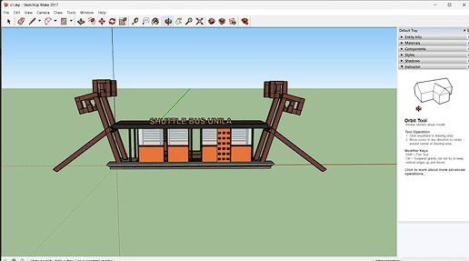

---
hide:
  - toc
  - navigation
---

# Projects

A selection of my geospatial projects. Click any card to see the full write-up.

**[3D Model of the Unila Shuttle Bus Stop](shuttle-bus-stop.md)**

A detailed 3D model of the Universitas Lampung shuttle bus stop, built from reference photos in SketchUp. A Ruby script automated the repetitive elements, while the Lampung-style ornaments were modelled by hand.

`SketchUp` `Ruby` `3D Modelling`

[View Project →](shuttle-bus-stop.md){ .md-button }

