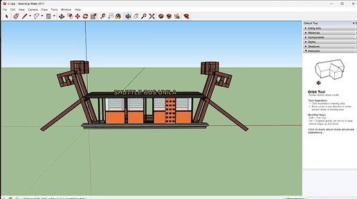

# 3D Model of the Unila Shuttle Bus Stop

## Overview

A detailed 3D model of the Universitas Lampung shuttle bus stop (halte), built in SketchUp for the Cadastral Survey course. A Ruby script, written with AI assistance from my own design, automated the repetitive modelling work, while the complex ornamental parts were built by hand. This was a modelling exercise based on photos, without field measurements.

**Study Area:** Universitas Lampung shuttle bus stop (Jl. Prof. Dr. Soemantri Brojonegoro No. 1, Gedong Meneng, Bandar Lampung)  
**Duration:** October 2026 – November 2026  
**Role:** Solo project  
**Status:** Completed  

---

## Methods & Tools

**Data Sources**

- 5 photos of the existing bus stop from different angles (front, back, side and interior), used for visual dimension estimation

**Processing Steps**

1. Collected reference photos and estimated the main dimensions (about 17 m × 4 m × 4.5 m, with a tower of about 10 m).
2. Designed the Ruby script logic to automate the main geometric elements: foundation, floor with Lampung motif, columns, roof, glass panels, benches, lights, decorative panels and 3D signage.
3. Ran the script in the SketchUp Ruby Console (SketchUp Make 2017) to generate the base structure parametrically.
4. Built and refined the complex architectural parts by hand: the G-scroll ornaments on the four corners, the slanted diagonal posts and the three-level connecting beams.

**Tools Used**

| Tool | Purpose |
|------|---------|
| SketchUp Make 2017 | 3D modelling of the bus stop |
| Ruby (SketchUp API) | Script to automate repetitive modelling steps, designed by me and written with AI assistance |

---

## Key Findings

- Produced a detailed 3D model (roughly LOD 200–300) covering basic structural elements through to Lampung-style ornaments.
- The Ruby script greatly reduced the time needed for repetitive components such as glass panels, column arrays and lighting, compared with fully manual modelling.
- The tower ornament and diagonal posts extend beyond the main body of the bus stop, which shows why 3D cadastral modelling (spatial rights and easements) can capture what a conventional 2D map cannot.
- Limitation: dimensions are visual estimates from photos, so the model is not survey-accurate. A next step would be to validate it with a Total Station or photogrammetry.

---

## Links

- [3D Modeling Halte Unila (Google Drive folder)](https://drive.google.com/drive/folders/1iQ01TbBsEE9cUeiq-CJMncRfrtQ00_cd?usp=sharing)